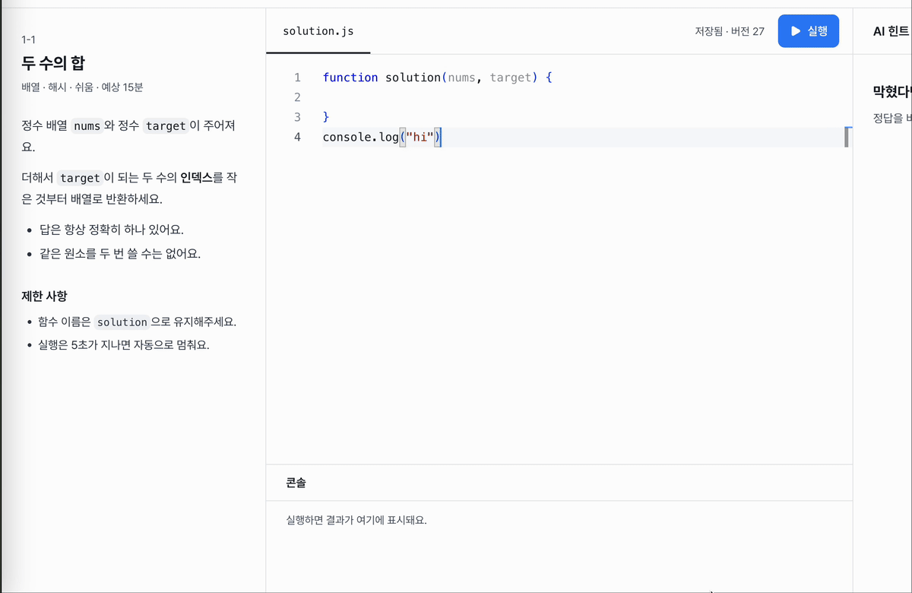
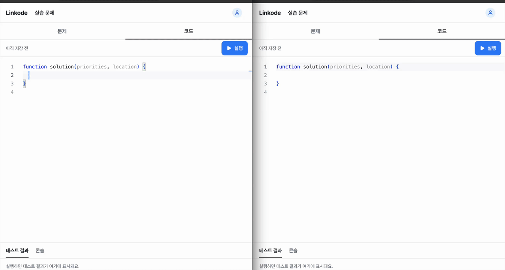
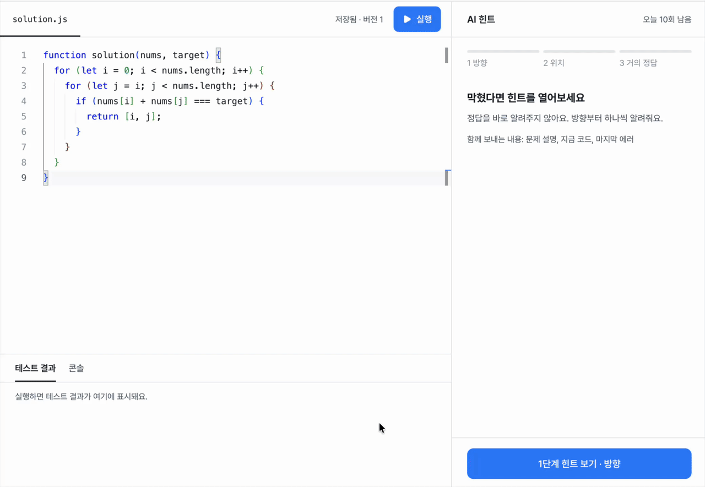
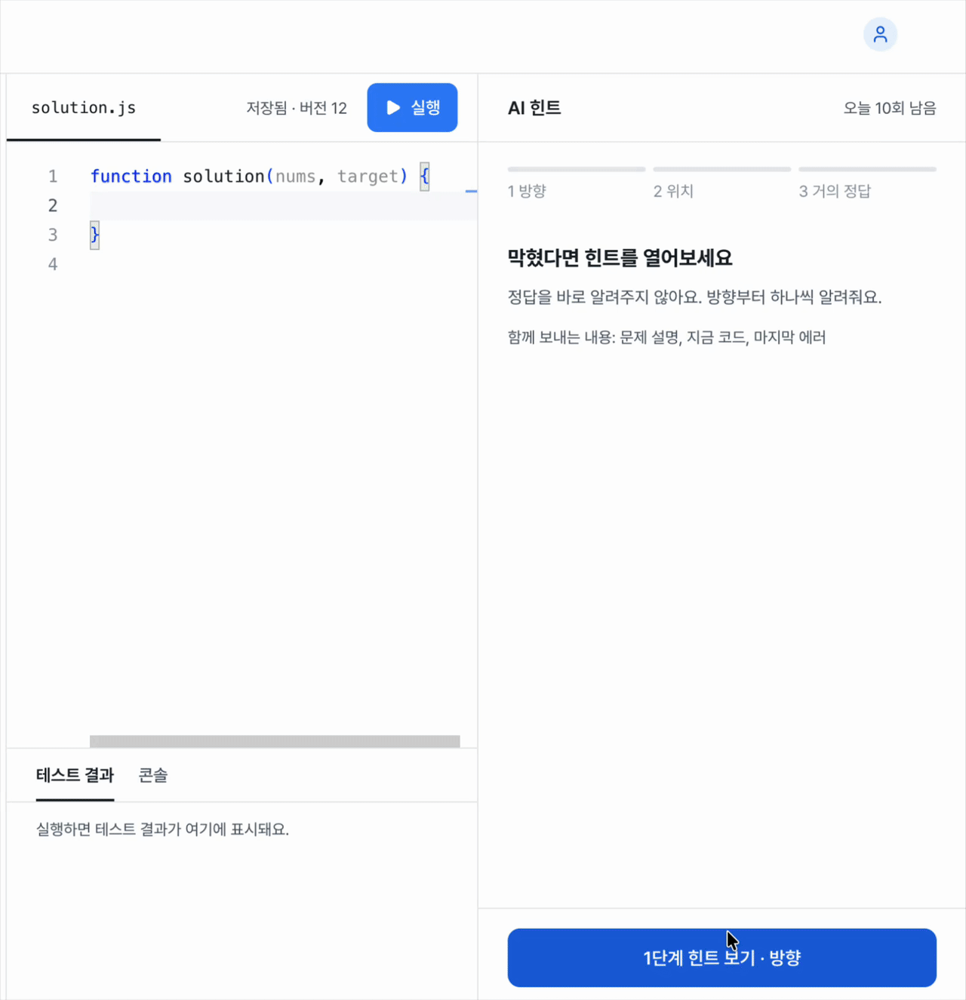
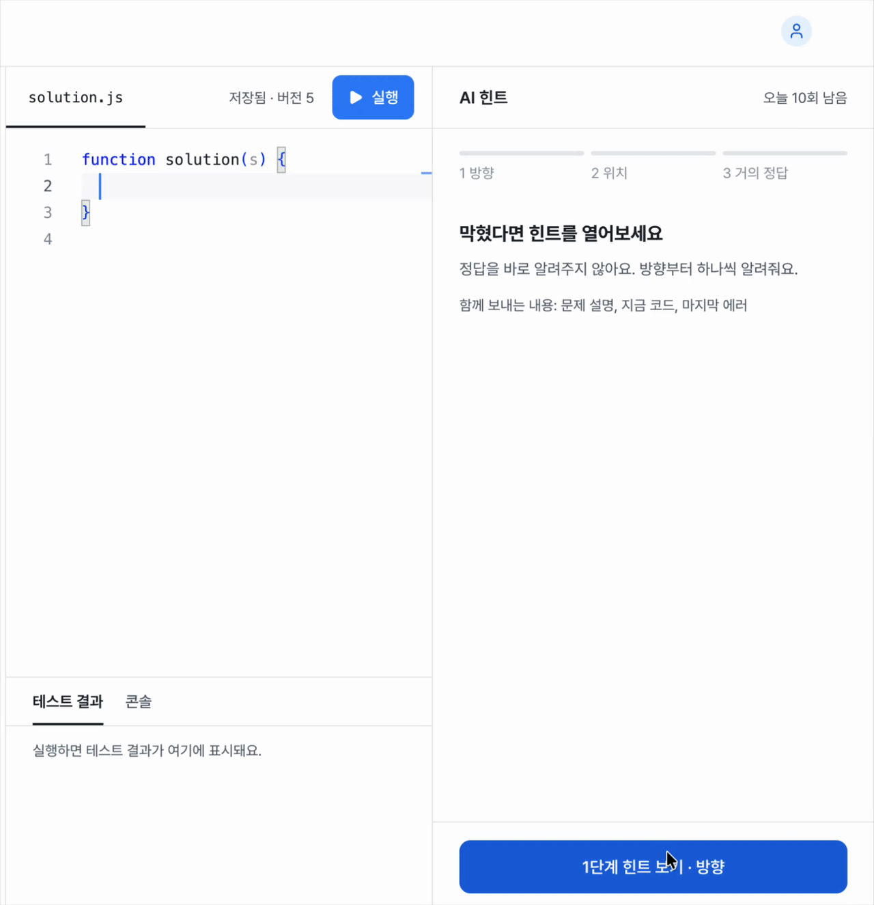

# Linkode

코딩 문제를 풀고, 작성한 코드를 브라우저에서 실행해 볼 수 있는 서비스입니다. 테스트 결과를 확인하고, 풀이가 막히면 AI에게 단계별 힌트를 요청할 수 있습니다.

**서비스:** https://linkode-frontend.vercel.app

## 기술 스택

Next.js 16 · TypeScript · Tailwind CSS v4 · shadcn/ui · TanStack Query · Supabase · Web Worker · SSE · Vitest · Vercel

## 주요 기능

### 코드 실행 및 채점

작성한 코드를 Web Worker에서 실행합니다. 실행 중 무한 루프가 발생해도 메인 화면은 멈추지 않으며, 5초가 지나면 Worker를 종료합니다.

- 테스트별 입력값, 기대값, 실제 결과, 실행 시간 표시
- 테스트가 끝날 때마다 결과를 전달해 시간 초과 전까지의 결과 유지
- `console.log` 출력은 별도 콘솔 탭에서 확인
- 모든 테스트를 통과하면 통과 기록을 저장하고 다음 문제로 이동

**실행 방식 비교**

| 메인 스레드에서 실행                          | Web Worker에서 실행                       |
| --------------------------------------------- | ----------------------------------------- |
|  |  |

### 코드 자동 저장

입력을 멈춘 뒤 2초가 지나면 코드를 저장합니다. 저장에 실패하면 5초 뒤 다시 시도합니다.

여러 탭에서 같은 코드를 수정하는 경우를 고려해 버전 번호를 이용한 낙관적 잠금을 적용했습니다.

- 저장 요청에 현재 코드 버전을 함께 전달
- 서버 버전과 다르면 기존 내용을 덮어쓰지 않고 충돌 처리
- 충돌이 발생하면 두 코드의 차이를 diff로 비교하고 저장할 내용을 선택



### AI 단계별 힌트

정답을 한 번에 알려주는 대신, 풀이에 필요한 정보를 단계별로 제공합니다.

1. **방향 제시:** 어떤 방식으로 접근할지 안내
2. **위치 안내:** 코드를 어디서 살펴봐야 할지 안내
3. **구체적인 힌트:** 정답에 가까운 방향 제시

이전 단계를 확인해야 다음 단계의 힌트를 요청할 수 있습니다.

현재 작성한 코드와 마지막 실행 에러를 함께 전달하기 때문에, 단순히 문제 설명만으로 답하는 것이 아니라 현재 풀이 상황을 참고합니다. 응답은 SSE로 스트리밍되며 요청 도중 취소할 수도 있습니다.

힌트를 받은 뒤 코드를 수정하면 이전 코드에 대한 힌트임을 화면에 표시합니다.



### 힌트 횟수 관리

힌트는 하루 10회까지 사용할 수 있고, 한국 시간 자정을 기준으로 횟수가 초기화됩니다. 한 사용자가 동시에 여러 힌트를 요청하는 것도 제한합니다.

요청 상태와 횟수 차감은 프론트엔드가 아닌 DB에서 관리합니다.

| 요청 상황                | 횟수 차감     |
| ------------------------ | ------------- |
| 응답을 받기 전 서버 오류 | 차감하지 않음 |
| 첫 글자가 오기 전 취소   | 차감하지 않음 |
| 첫 글자를 받은 뒤 취소   | 차감          |
| 응답 완료                | 차감          |

- DB 함수에서 요청 가능 여부 확인과 요청 생성을 함께 처리
- 부분 유니크 인덱스로 사용자당 진행 중인 요청을 1개로 제한
- 첫 글자를 받으면 화면의 남은 횟수를 먼저 갱신
- 서버가 중단되어 남아 있는 요청은 2분이 지난 뒤 다음 요청에서 정리하고 횟수를 복구

### 익명 로그인

별도 회원가입 없이 서비스를 체험할 수 있도록 Supabase 익명 인증을 사용했습니다. 방문자마다 별도의 계정을 발급해 각자의 풀이와 저장 데이터가 섞이지 않도록 했습니다.

## 구현하면서 해결한 문제

### 1. 무한 루프가 발생하면 브라우저 전체가 멈추는 문제

처음에는 학생 코드를 메인 스레드에서 실행했습니다. 하지만 `while(true)`처럼 종료되지 않는 코드가 실행되면 이벤트 루프가 막혀 화면을 조작할 수 없었습니다. 실행 제한 시간을 두더라도 메인 스레드의 타이머 자체가 실행되지 않는 상황이었습니다.

코드 실행을 Web Worker로 옮기고, 메인 스레드에서 5초 타이머를 관리하도록 변경했습니다. 제한 시간이 지나면 `worker.terminate()`로 실행을 강제 종료합니다.

추가로 다음 사항도 처리했습니다.

- 테스트 결과를 한꺼번에 전달하지 않고 테스트가 끝날 때마다 전달
- 실행마다 `runId`를 부여해 이전 실행에서 늦게 도착한 메시지는 무시
- `structuredClone`으로 테스트 인자를 복사해 학생 코드가 원본 데이터를 변경하지 못하도록 처리

이렇게 변경한 뒤에는 무한 루프가 발생해도 화면이 멈추지 않고, 제한 시간까지 완료된 테스트 결과도 확인할 수 있습니다.

### 2. 취소한 AI 요청이 서버에서는 완료 처리되는 문제

힌트 요청을 보낸 직후 취소했는데, 화면에는 아무 글자도 나타나지 않은 반면 DB에는 `completed`, `charged = true`로 기록되는 문제가 있었습니다.

확인해 보니 서버에서 스트림을 시작하기 전에 DB 요청을 여러 번 처리하고 있었습니다. 이 과정에서 클라이언트가 먼저 요청을 취소하면 `abort` 이벤트가 이미 발생한 뒤였습니다.

문제는 이미 발생한 이벤트를 나중에 등록한 리스너가 다시 받을 수 없다는 점이었습니다.

리스너를 등록한 직후 `signal.aborted`를 확인하도록 수정했습니다.

```ts
request.signal.addEventListener("abort", () => {
  abortController.abort();
});

if (request.signal.aborted) {
  abortController.abort();
}
```

수정 후에는 첫 글자를 받기 전에 취소된 요청이 `aborted` 상태로 기록되고, 힌트 횟수도 차감되지 않는 것을 확인했습니다.

이 문제를 해결하면서 클라이언트 화면뿐 아니라 실제 DB에 저장된 요청 상태와 차감 여부까지 함께 확인해야 한다는 점을 배웠습니다.

### 3. SSE로 받은 한글이 깨지는 문제

SSE 응답을 청크 단위로 문자열로 변환했을 때 한글이 깨지는 현상이 있었습니다.

네트워크에서 전달되는 데이터는 바이트 단위로 나뉘기 때문에 한글 한 글자의 바이트가 여러 청크에 걸쳐 전달될 수 있습니다. 각 청크를 별도로 디코딩하면 완성되지 않은 문자가 깨질 수 있었습니다.

`TextDecoder`를 파서 외부에 하나만 생성하고, `stream: true` 옵션으로 이전 청크의 미완성 바이트를 이어서 처리하도록 했습니다.

이벤트 파싱도 청크 경계와 분리했습니다.

- `\n\n`을 기준으로 이벤트를 구분
- 이벤트가 완성되지 않았으면 버퍼에 남겨 다음 청크와 결합
- 서버에서 데이터를 JSON으로 전달해 힌트 내용의 줄바꿈과 이벤트 구분자를 혼동하지 않도록 처리

한글이 바이트 중간에서 잘리는 상황을 포함해 파서 테스트 8개를 작성했고 모두 통과했습니다.

### 4. 실습 페이지에 다시 진입하면 Monaco 에디터가 동작하지 않는 문제

문제 목록에서 실습 페이지에 들어갔다가 다시 목록으로 돌아온 뒤, 같은 실습 페이지에 재진입하면 배포 환경에서 에디터가 정상적으로 열리지 않았습니다.

원인은 `cacheComponents` 설정이었습니다. 이 설정을 켜면 Next.js가 이전 페이지를 지우지 않고 React `<Activity>`로 숨겨 보존합니다.

페이지가 숨겨질 때 Monaco 에디터의 effect cleanup이 실행되면서 에디터 인스턴스는 dispose됐지만, 라이브러리의 준비 상태는 그대로 남아 있었습니다. 이후 페이지가 다시 보일 때 이미 제거된 인스턴스를 재사용하면서 오류가 발생했습니다.

화면의 표시 여부를 확인하는 `useIsVisible` 훅을 만들고, 화면에 보일 때만 에디터를 생성하도록 변경했습니다.

처음에는 effect 안에서 바로 상태를 변경했지만 `react-hooks/set-state-in-effect` 규칙에 걸려 `requestAnimationFrame`으로 상태 변경 시점을 조정했습니다.

수정 후에는 페이지를 여러 번 이동해도 에디터가 정상적으로 생성되는 것을 확인했습니다. 페이지 보존 기능은 유지했습니다.

### 5. 여러 탭에서 동시에 힌트를 요청하는 문제

화면에서 요청 버튼을 비활성화하는 것만으로는 동시 요청을 막을 수 없습니다. 사용자가 여러 탭을 열거나 API를 직접 호출하면 같은 사용자가 여러 요청을 보낼 수 있기 때문입니다.

확인과 저장을 서버 코드에서 두 단계로 나누면, 그 사이에 다른 요청이 들어와 두 요청이 모두 통과할 수 있습니다. 그래서 처음부터 DB 함수 `start_hint_request` 하나에서 확인과 생성을 함께 처리하도록 설계했습니다.

- 사용자별 진행 중인 요청을 부분 유니크 인덱스로 제한
- 동시에 들어온 두 번째 요청은 `unique_violation`을 받아 거절
- 서버가 비정상 종료되어 남은 요청은 2분 뒤 다음 요청에서 정리
- `in_progress`, `already_opened`, `stage_locked`, `quota_exceeded` 등 상황에 따라 다른 응답 반환

프론트엔드 버튼 상태와 관계없이 DB에서 동시 요청을 제한합니다.

### 6. 에디터에 입력할 때마다 실습 화면의 React 컴포넌트가 리렌더링되는 문제

React DevTools의 렌더링 하이라이트로 확인해 보니, 에디터에 한 글자를 입력할 때마다 힌트 패널과 콘솔 패널을 포함한 실습 화면의 React 컴포넌트들이 불필요하게 리렌더링되고 있었습니다.

원인은 코드 상태의 위치였습니다. 입력한 코드를 실습 화면 컴포넌트의 `useState`로 관리했기 때문에, 글자가 바뀔 때마다 그 컴포넌트와 모든 자식 컴포넌트가 리렌더링됐습니다. 자동 저장도 이 상태 변화를 `useEffect`로 감지해 디바운스 타이머를 다시 걸고 있었습니다.

코드 값이 실제로 필요한 곳을 확인해 보니 실행, 힌트 요청, 충돌 비교는 모두 버튼을 누르는 순간에만 최신 코드가 필요했습니다. 코드가 바뀌는 것 자체는 UI를 갱신해야 하는 상태 변화가 아니었고, 사용하는 시점에 최신 값만 읽으면 됐습니다.

- 최신 코드를 `useState` 대신 `useRef`에 보관하고, 실행·힌트 요청은 클릭 시점에 ref에서 읽도록 변경
- 자동 저장 타이머를 `useEffect`가 아니라 에디터의 입력 이벤트에서 직접 다시 걸도록 변경
- 저장이 끝나면 `useMutation`의 `onSettled`에서 후속 처리: 실패했으면 5초 뒤 재시도하고, 저장하는 동안 새로 입력된 코드가 있으면 2초 뒤 다시 저장해 누락을 막음
- 충돌 비교 화면은 "차이 보기"를 누를 때만 최신 코드를 상태에 복사

수정 후에는 React DevTools 하이라이트 기준으로, 입력하는 동안 실습 화면의 React 컴포넌트 리렌더링이 발생하지 않습니다. 에디터 안의 글자는 Monaco Editor가 React 밖에서 직접 갱신합니다. 리렌더링은 입력을 멈춘 뒤 저장이 시작될 때(mutation이 pending 상태가 되어 "저장 중" 표시)와 완료될 때(pending 해제와 새 버전 반영으로 "저장됨" 표시) 각각 한 번씩만 발생합니다. `onSettled`는 ref와 타이머만 다루고 상태를 바꾸지 않아 추가 렌더링을 만들지 않습니다.

| 수정 전 | 수정 후 |
|---|---|
|  |  |

전역 변수로 코드를 관리하는 방법도 검토했지만, 페이지 보존 기능 때문에 여러 실습 화면이 동시에 살아 있을 수 있어 문제 사이에 코드가 섞일 위험이 있었습니다. 저장할 때 남는 두 번의 렌더링은 빈도가 낮고 비용이 작아 `memo`로 복잡도를 늘리지 않고 그대로 두었습니다.

## 개선할 점

- **브라우저 채점 결과:** 현재 통과 기록은 브라우저에서 실행한 채점 결과를 기준으로 합니다. 서버에서 재채점하려면 별도의 코드 실행 샌드박스가 필요합니다. 순위나 보상처럼 결과의 신뢰성이 중요해지면 서버 재채점 구조가 필요합니다.
- **익명 계정의 횟수 우회:** 새 익명 계정을 만들면 힌트 사용 횟수를 다시 확보할 수 있습니다. 서비스 전체 상한이나 IP 기반 제한은 추가로 고려하고 있습니다.
- **프롬프트 인젝션:** 학생 코드를 `<student_code>` 태그로 감싸 모델에 전달하고 관련 시나리오를 테스트했지만, 프롬프트 인젝션을 완전히 차단할 수 있다고 보기는 어렵습니다.
